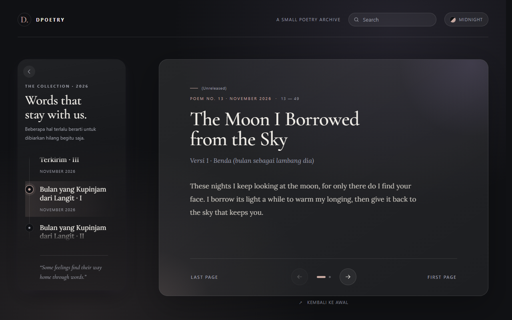
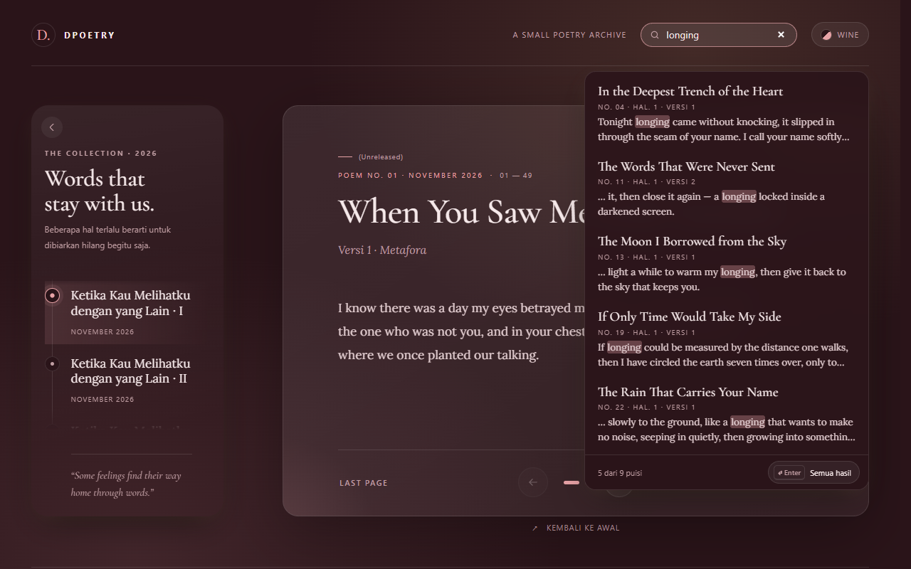
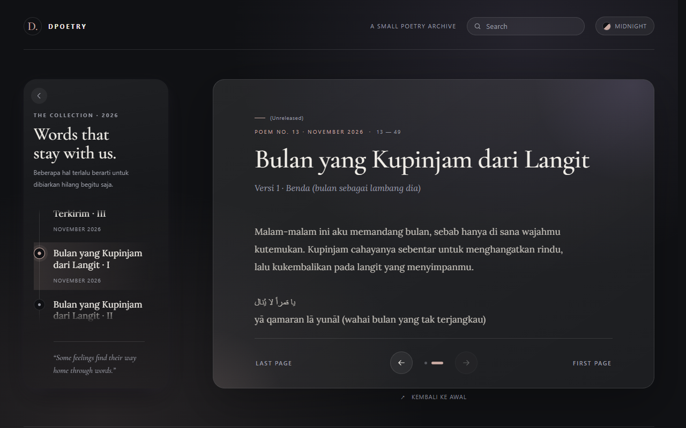
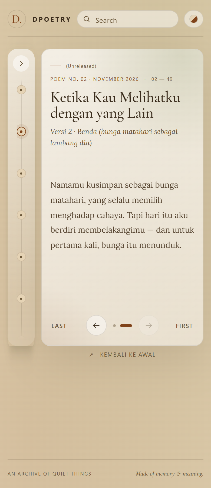
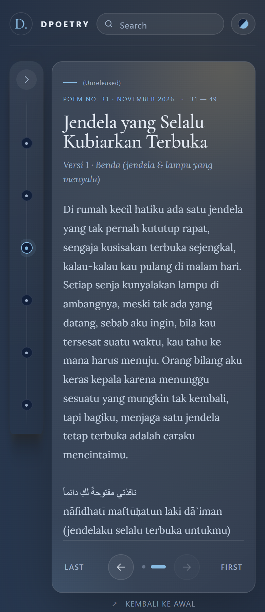
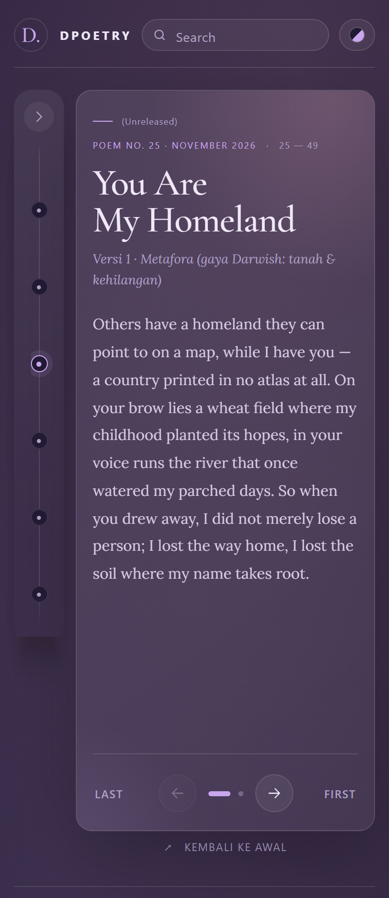
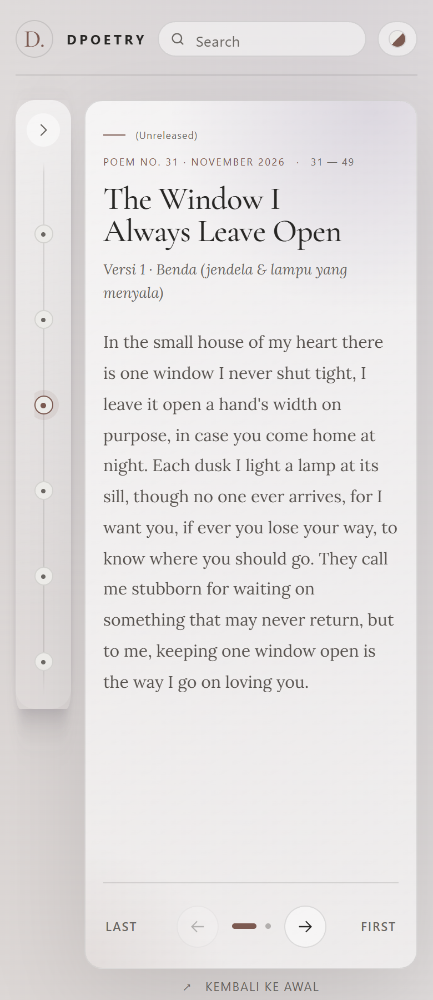
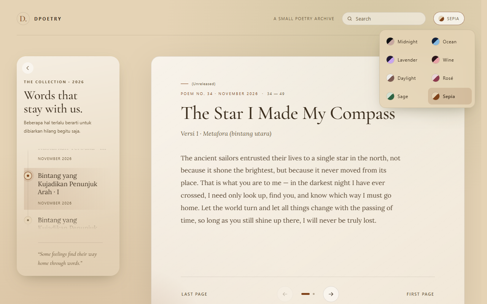
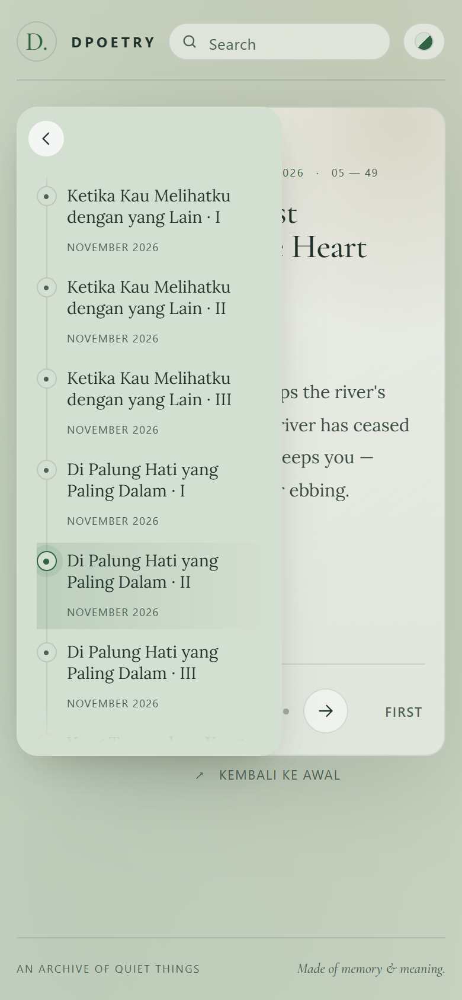

<h1 align="center">DPOETRY</h1>
<h3 align="center"><i>Unreleased</i></h3>

  An Archive of Quiet Things — Made of memory &amp; meaning. 
  A small poetry archive on the web: one poem at a time, two pages each, in Indonesian and English.

  
  
  

  <a href="https://abdani.github.io/dpoetry/"><b>🌐 Preview</b></a> · phone, tablet and desktop

> [!NOTE]
> **Unreleased.** The poems are still being corrected and revised, so text, titles and translations may change before the first release.

  Among these poems, there is one I wrote especially for someone I admire and hold dear, 
  from the deepest part of my heart:

<h3 align="center">✨ Star Vessel ✨</h3>

  <i>I hope it finds its way to her, and that one day she reads it too.</i>

## Preview

   
  <b>English page</b> · Midnight

   
  <b>Word search</b> · top 5 with highlighted snippets, <kbd>Enter</kbd> for all · Wine

### A line of Arabic

Each poem opens with its English page; the Indonesian page follows and often closes with a single line of Arabic, its transliteration and meaning.

   
  <b>Indonesian page with Arabic</b> · Midnight

### On phones

<table align="center">
  <tr>
    <td align="center">
       
      <b>Indonesian page</b> · Sepia
    </td>
    <td align="center">
       
      <b>Indonesian page</b> · Ocean
    </td>
  </tr>
  <tr>
    <td align="center">
       
      <b>English page</b> · Lavender
    </td>
    <td align="center">
       
      <b>English page</b> · Daylight
    </td>
  </tr>
</table>

## What's inside

- Poems in Indonesian and English: the English page comes first, then the Indonesian page.
- Several titles come in more than one version, each written with a different approach: a metaphor, an object, distance or a feeling.
- *Star Vessel* in full, plus a few earlier poems.
- Every poem has exactly **two pages**.

## Features

| Feature | Details |
| --- | --- |
| **Two-page reader** | Turn pages with the arrow buttons, the page dots, a swipe, or <kbd>←</kbd> <kbd>→</kbd>. The title follows the language of the page. |
| **Floating timeline** | A vertical list of every poem on the left. It folds into a slim rail of dots; on phones it opens over the poem and closes when you pick one. |
| **First / Last** | Jump straight to the first or the last poem. |
| **Word search** | Finds words in poems, titles and notes, ignoring case, accents and Arabic harakat. Shows the top 5 with a highlighted two-line snippet; press <kbd>Enter</kbd> for every result. |
| **Eight color themes** | Midnight, Ocean, Lavender, Wine, Daylight, Rosé, Sage and Sepia, all checked for readable contrast (WCAG). Your choice is remembered. |
| **Smooth on phones** | Animations run on the GPU and were measured on an Android-like profile. Respects *reduce motion*. |
| **Responsive** | From 320 px phones to wide desktops. |

<table>
  <tr>
    <td align="center" width="65%">
       
      <b>Color themes</b> · shown here in Sepia
    </td>
    <td align="center" width="35%">
       
      <b>Floating timeline</b> on a phone · Sage
    </td>
  </tr>
</table>

## Run it locally

No build step and nothing to install: open `index.html` in a browser.

## Built with

| Component | Purpose | License |
| --- | --- | --- |
| HTML, CSS and JavaScript in one file | The whole site | — |
| [Lora](https://fonts.google.com/specimen/Lora) and [Cormorant Garamond](https://fonts.google.com/specimen/Cormorant+Garamond) via Google Fonts | Reading text and headings | SIL OFL 1.1 |
| [GitHub Pages](https://pages.github.com/) | Hosting | — |

*Star Vessel* is inspired by 星のうつわ (Hoshi no Utsuwa) by Sukima Switch.
